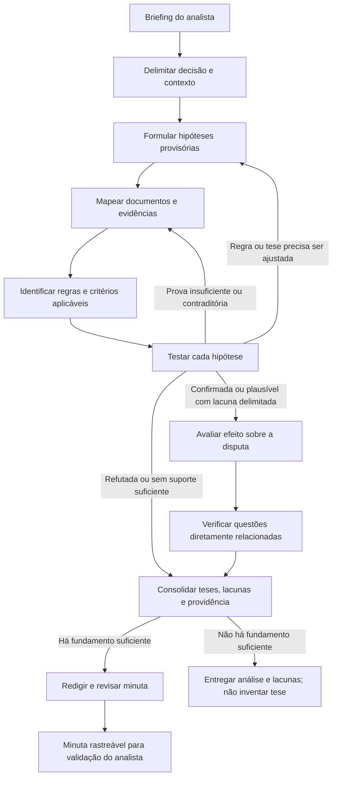

# Fluxo operacional da skill de elaboração de recurso

## Objetivo e escopo

Este fluxo orienta a futura skill a analisar e apoiar a elaboração de recurso administrativo em licitação de serviços com dedicação exclusiva de mão de obra. O trabalho parte do briefing do analista e dos documentos disponíveis, testa as inconsistências indicadas e só converte em tese recursal aquilo que tiver suporte documental e fundamento aplicável.

Os recursos anteriormente estudados são apenas material de desenvolvimento: suas lições generalizadas já estão registradas nos documentos de briefing e estrutura. A skill em uso não deve consultá-los, citá-los, exigir acesso a eles nem reaproveitar fatos, argumentos ou dados específicos dos casos.

## Visão do fluxo

O processo não é uma sequência rígida de pesquisa. É um ciclo controlado entre hipótese, documentos, critério aplicável e teste. A skill pode voltar a uma etapa anterior quando a evidência contradizer a hipótese ou revelar que o critério foi compreendido de forma incompleta.

## Princípio de contribuição entre etapas

Uma atividade deve ser feita quando contribuir para pelo menos um destes resultados:

- concluir a etapa atual com uma saída verificável;
- reduzir uma incerteza relevante para a etapa seguinte;
- identificar uma lacuna que impeça uma conclusão responsável.

Pesquisa, leitura ou cálculo que não se conecte à decisão contestada, à hipótese sob análise ou ao efeito na disputa não deve ser ampliado por curiosidade. Se uma informação não muda a conclusão, o grau de confiança, a providência ou a redação, em regra não é necessário aprofundá-la.

## Etapas e orientações

### 1. Interpretar e normalizar o briefing

**Finalidade:** converter a descrição do analista em um problema de análise delimitado, sem exigir que ele já conheça a tese jurídica.

**A skill deve:**

- identificar a decisão contestada, o problema percebido e o efeito alegado sobre a disputa;
- separar fatos que o analista afirma ter observado de interpretações ou suspeitas;
- registrar a providência pretendida, se informada, como preferência a ser testada — não como conclusão obrigatória;
- perceber se o relato aponta mais de uma questão e separá-las para análise individual.

**Saída da etapa:** resumo neutro do caso em três partes: ato questionado, inconsistência percebida e efeito alegado; mais uma lista de dúvidas materiais, se houver.

**Contribuição e critério de conclusão:** esta etapa está concluída quando a skill consegue explicar, sem ampliar o relato, o que está sendo questionado e por quê. Isso fornece o ponto de partida para delimitar o ato e formular hipóteses na etapa 2. Se a única lacuna for uma informação extraível dos arquivos, não perguntar ao analista ainda.

### 2. Delimitar a decisão e o contexto do certame

**Finalidade:** garantir que a análise examine o ato correto, no item/lote e sob o regime jurídico pertinentes.

**A skill deve:**

- extrair dos documentos, quando disponíveis, órgão, número, objeto, item/lote, licitantes relevantes, decisão, fase e datas;
- identificar qual ato será recorrido — por exemplo, aceitação/classificação de proposta, habilitação ou inabilitação — e não confundir consequências distintas;
- identificar no edital o regime jurídico e os regulamentos indicados; não presumir que toda contratação está sujeita exclusivamente à Lei nº 14.133/2021;
- verificar o rito recursal, os prazos e os requisitos de admissibilidade pertinentes. Quando o pedido já for elaborar recurso, partir da premissa de que a intenção de recorrer foi manifestada, salvo evidência contrária ou dúvida material;
- solicitar esclarecimento ao analista apenas quando faltar dado que não possa ser obtido dos arquivos e que altere a delimitação ou a viabilidade do recurso.

**Saída da etapa:** ficha concisa do certame e do ato recorrido, com regime, fase e requisitos processuais que precisem ser confirmados.

**Contribuição e critério de conclusão:** concluir quando estiver claro qual decisão, em qual parte do certame e sob qual rito será examinada. Isso impede que as hipóteses da etapa 3 sejam formuladas contra um ato ou parâmetro errado. Registros de sessão, chat e logs não são requisito universal; buscá-los apenas se um fato controvertido depender deles, como cronologia, diligência, manifestação ou tratamento desigual.

### 3. Formular hipóteses provisórias a partir do briefing

**Finalidade:** transformar o problema percebido em questões testáveis, sem declarar antecipadamente que houve ilegalidade ou que o recurso será provido.

**A skill deve, para cada hipótese:**

- descrever o possível descumprimento em linguagem provisória e específica;
- apontar qual regra ou critério pode ser relevante, inicialmente como hipótese a confirmar;
- indicar que fato precisaria ser demonstrado para confirmar ou refutar a hipótese;
- prever explicações alternativas plausíveis, como erro sanável, diligência permitida, interpretação diferente do edital ou ausência de impacto;
- manter em separado questões de proposta/preço e questões de habilitação, salvo quando a relação entre elas for demonstrada.

**Saída da etapa:** uma lista curta de hipóteses, cada qual acompanhada de fato a testar, possível critério e alternativas. Exemplo de molde: “Se a proposta deixou de contemplar o custo X, verificar se o edital o exigia, se a versão final da planilha o contém e se a falha altera preço, exequibilidade ou apenas demanda correção”.

**Contribuição e critério de conclusão:** uma hipótese é útil quando permite dizer quais evidências procurar na etapa 4. Hipóteses vagas (“houve direcionamento”, “a proposta é inexequível”) ou sem relação com o briefing devem ser refinadas ou descartadas antes de ampliar a pesquisa.

### 4. Mapear e examinar documentos e evidências

**Finalidade:** localizar a prova necessária para testar cada hipótese e registrar sua origem com precisão.

**A skill deve:**

- começar pelo núcleo documental pertinente: edital e anexos aplicáveis, proposta final/PCFP quando a controvérsia envolver proposta ou custos, e decisão/avaliação contestada;
- selecionar documentos adicionais conforme a hipótese, em vez de exigir indiscriminadamente todo o processo;
- examinar versões finais, retificações, diligências, respostas e documentos complementares quando puderem alterar a conclusão;
- registrar para cada evidência arquivo, página, cláusula, aba/célula, trecho ou outro localizador que permita conferência;
- distinguir conteúdo documental explícito de inferência feita a partir dele;
- anotar também evidência contrária ou que limite a alegação, não apenas elementos favoráveis;
- apontar documento central ausente e explicar exatamente o que ele permitiria verificar.

**Saída da etapa:** mapa de evidências por hipótese, contendo evidência favorável, evidência contrária, localização e lacunas. Documentos condicionais devem ser solicitados somente se necessários à tese concreta.

**Contribuição e critério de conclusão:** concluir quando houver material suficiente para comparar o fato alegado com o critério, ou quando estiver identificada uma lacuna decisiva. O mapa alimenta a etapa 5 (definição precisa do critério) e a etapa 6 (teste). Se surgir evidência que contradiga ou altere a hipótese, voltar à etapa 3 em vez de ignorá-la.

### 5. Identificar a regra e o critério aplicáveis

**Finalidade:** estabelecer o padrão correto de avaliação antes de concluir que um documento ou decisão o violou.

**A skill deve:**

- localizar primeiro a exigência concreta do edital, seus anexos, retificações e esclarecimentos relevantes;
- identificar o regime jurídico do certame e consultar a legislação e regulamentação compatíveis com o órgão e o objeto;
- em controvérsias trabalhistas, conferir instrumento coletivo, categoria, base territorial e vigência, sem presumir que toda licitante deva adotar a mesma CCT indicada por terceiros;
- usar instruções normativas, decretos e regras setoriais apenas após conferir seu âmbito de aplicação;
- quando jurisprudência ou súmula for relevante, verificar fonte oficial, teor/contexto, vigência, semelhança fática e alcance; não usar número ou ementa sem conferir o conteúdo;
- distinguir obrigação vinculante do certame, norma aplicável, orientação jurisprudencial e argumento interpretativo.

**Saída da etapa:** critério de comparação claro e rastreável por hipótese: texto/regra, fonte, aplicabilidade e consequência prevista ou juridicamente possível.

**Contribuição e critério de conclusão:** concluir quando for possível formular o padrão com o qual o fato será comparado. Isso permite testar a hipótese na etapa 6. Se não for possível confirmar a aplicação de uma norma ou precedente, registrar a incerteza e não apresentá-lo como fundamento certo.

### 6. Testar as hipóteses contra evidências e critérios

**Finalidade:** decidir o que os documentos efetivamente demonstram, inclusive quando a resposta não confirma a suspeita inicial.

**A skill deve:**

- comparar, ponto a ponto, critério e evidência;
- testar tanto a leitura favorável quanto as explicações alternativas e a prova contrária;
- classificar cada hipótese como **confirmada**, **refutada** ou **inconclusiva**, explicando por quê;
- separar fato comprovado, inferência plausível e afirmação ainda sem prova;
- voltar às etapas 3, 4 ou 5 quando a análise revelar hipótese mal delimitada, documento faltante ou critério incorreto;
- não tratar erro isolado de planilha como causa automática de desclassificação: verificar regras de saneamento, diligência, suficiência do preço e efeito sobre a proposta;
- não afirmar fraude, falsidade, inexequibilidade, vício insanável ou impossibilidade de saneamento sem evidência e fundamento adequados.

**Saída da etapa:** conclusão fundamentada por hipótese, com grau de certeza e lacunas que permanecem.

**Contribuição e critério de conclusão:** uma hipótese só avança como tese potencial quando a comparação revela suporte suficiente para uma alegação específica. A classificação também orienta a etapa 7: somente hipóteses confirmadas ou plausíveis com lacuna delimitada justificam avaliar consequência recursal; hipóteses refutadas devem ser excluídas ou explicadas ao analista.

### 7. Avaliar materialidade e efeito sobre a disputa

**Finalidade:** verificar se a inconsistência tem relevância para a decisão e qual consequência é proporcional ao que foi demonstrado.

**A skill deve:**

- estabelecer o nexo entre o problema comprovado e a decisão contestada;
- avaliar se a falha altera classificação, aceitabilidade, exequibilidade, habilitação, igualdade de competição ou outro resultado relevante;
- diferenciar vício corrigível/diligenciável de falha que, conforme a regra e o caso, possa justificar revisão, desclassificação ou inabilitação;
- não presumir que a recorrente passará automaticamente à posição vencedora após a revisão; conferir a ordem e as etapas ainda necessárias;
- confrontar a consequência jurídica possível com o efeito percebido informado pelo analista.

**Saída da etapa:** explicação do impacto demonstrado (ou da ausência dele) e das consequências que podem ser sustentadas.

**Contribuição e critério de conclusão:** concluir quando a skill consegue responder “o que muda no certame se esta alegação for aceita?”. Essa resposta fundamenta a seleção de teses e pedidos nas etapas 9 e 10. Sem nexo demonstrado, não ampliar retórica para compensar a falta de materialidade.

### 8. Fazer uma verificação limitada de questões diretamente relacionadas

**Finalidade:** evitar que a análise deixe passar uma questão evidente e inseparável do problema apresentado, sem transformá-la em auditoria irrestrita da licitação.

**A skill deve:**

- revisar se a prova já examinada revela outra inconsistência diretamente conectada ao ato e à hipótese principal;
- incluir uma questão adicional somente se ela tiver relação material clara, suporte nos documentos e utilidade para a disputa;
- explicitar ao analista quando a nova questão não foi indicada originalmente no briefing;
- não procurar irregularidades genéricas em todo o certame nem inventar tese para aumentar o número de fundamentos.

**Saída da etapa:** confirmação de que não há questão correlata relevante, ou hipótese adicional delimitada que retorna às etapas 3 a 7 para validação.

**Contribuição e critério de conclusão:** a verificação termina quando as questões diretamente relacionadas foram incluídas no mesmo ciclo de teste ou descartadas com motivo. Isso torna a consolidação da etapa 9 completa sem expandir indevidamente o escopo.

### 9. Consolidar teses, lacunas e providência recomendada

**Finalidade:** decidir quais conclusões podem compor o recurso e qual pedido corresponde à prova e à fase do procedimento.

**A skill deve:**

- selecionar apenas teses confirmadas ou que possam ser apresentadas com ressalva clara e lacuna delimitada;
- excluir hipóteses refutadas e não converter suspeitas inconclusivas em afirmações categóricas;
- para cada tese selecionada, consolidar a cadeia: **regra aplicável → evidência localizada → comparação → efeito no julgamento → providência**;
- propor pedido principal e, se juridicamente cabível, pedido subsidiário compatível com as alternativas de fato e de direito;
- testar a providência pretendida pelo analista; explicar eventual divergência e recomendar medida proporcional;
- decidir se há suporte para minuta. Se não houver, entregar análise das razões e lacunas em vez de produzir peça artificialmente conclusiva.

**Saída da etapa:** quadro final de teses e situação, providência recomendada, pontos que dependem de validação ou documento adicional e decisão de redigir ou não a minuta.

**Contribuição e critério de conclusão:** esta etapa converte a análise em um plano de redação. Ela só está concluída quando cada pedido tem uma tese e um efeito demonstrado que o sustentem; isso delimita a minuta da etapa 10.

### 10. Redigir e revisar a minuta

**Finalidade:** apresentar razões claras, verificáveis e proporcionais à análise concluída.

**A skill deve:**

- organizar a peça com identificação do processo e das partes, admissibilidade conforme o rito, síntese do ato e fundamentos separados por questão material;
- em cada fundamento, seguir a cadeia **regra → evidência → comparação → consequência → pedido**, citando localizadores documentais precisos;
- usar datas, valores, nomes, números e referências jurídicas conferidos nos documentos ou em fonte oficial;
- fazer pedidos principal e subsidiário somente quando pertinentes e sustentados;
- evitar repetição, conclusões categóricas sem prova, citações não verificadas e argumentos genéricos que não respondam à decisão recorrida;
- sinalizar campos não disponíveis ou fatos que precisam de confirmação pelo analista; não preencher lacunas com dados inventados;
- revisar coerência entre decisão contestada, teses, prova, efeito e pedidos, além de conferir admissibilidade e prazo conforme o rito concreto.

**Saída da etapa:** minuta rastreável para revisão e validação do analista, ou, se a análise não encontrou base suficiente, relatório conciso explicando por que não é recomendável redigir um recurso conclusivo.

**Contribuição e critério de conclusão:** a peça está pronta para validação quando outra pessoa consegue conferir cada alegação material nos documentos e entender por que o pedido decorre dela. A revisão final fecha o fluxo; falha de rastreabilidade ou contradição relevante exige retorno à etapa correspondente.

## Quadro de controle por tese

Durante as etapas 3 a 9, manter para cada tese um registro equivalente a este:

| Campo | Pergunta de controle |
|---|---|
| Decisão/ato | Qual ato é questionado e em que ponto do certame? |
| Hipótese | Qual inconsistência específica está sendo testada? |
| Critério | Qual cláusula, norma ou entendimento aplicável estabelece o parâmetro? |
| Evidência favorável | Que documento demonstra o fato e onde está localizado? |
| Evidência contrária | O que limita ou contradiz a alegação? |
| Lacuna | Que dado/documento falta e ele é decisivo? |
| Resultado do teste | Confirmada, refutada ou inconclusiva? Por quê? |
| Efeito | Como o fato afeta a decisão ou a disputa? |
| Providência | Qual medida é proporcional e tem suporte? |

## Regras de passagem e encerramento

- Não avançar da hipótese à tese sem identificar critério e evidência pertinentes.
- Não avançar à minuta sem analisar evidências contrárias e o efeito material da alegação.
- Não solicitar informação que possa ser extraída com segurança dos arquivos.
- Pedir complemento ao analista somente quando a lacuna for material, não puder ser suprida pelos documentos e impedir uma conclusão ou redação responsável.
- Se não houver fundamento suficiente, dizer isso claramente, indicar o que foi refutado ou permaneceu inconclusivo e evitar fabricar um recurso apenas para atender à forma do pedido.
- Em qualquer etapa, interromper aprofundamento que não ajude a concluir a questão atual, preparar a próxima ou revelar uma lacuna decisiva.

## Referências internas relacionadas

- [Briefing mínimo para análise e elaboração de recurso](Briefing_Minimo.md) — entradas do analista e informações extraídas dos documentos.
- [Documentos e fundamentação para recurso](Documentos_e_Fundamentacao_do_Recurso.md) — núcleo documental, documentos condicionais e fontes jurídicas.
- [Análise de recursos anteriores e estrutura recomendada](Analise_Recursos_Modelo_Estrutura.md) — padrões generalizados de organização e redação; os exemplos originais não são insumos de execução da skill.
