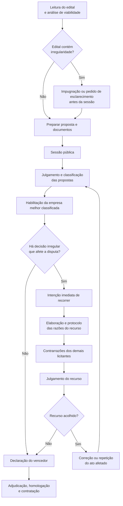

# Fluxo de análise da licitação e elaboração de recurso

Este fluxo apresenta, em alto nível, o caminho de atuação de um licitante desde a publicação do edital até a contratação. O recurso administrativo aparece após decisões tomadas durante a disputa, especialmente no julgamento das propostas ou na habilitação.

## Etapas principais

1. **Leitura do edital e análise de viabilidade**
   - O licitante examina o objeto, os requisitos técnicos, a habilitação, os prazos, os riscos e a viabilidade econômica de participar.

2. **Impugnação ou pedido de esclarecimento — se necessário**
   - Antes da abertura da sessão, irregularidades ou ambiguidades do edital podem ser questionadas. Pela Lei nº 14.133/2021, a impugnação e o pedido de esclarecimento devem ser protocolados até 3 dias úteis antes da abertura do certame.

3. **Preparação da proposta e dos documentos**
   - São organizados preço, planilhas, especificações técnicas, declarações e documentos de habilitação exigidos pelo edital.

4. **Sessão pública**
   - Ocorrem o envio ou a abertura das propostas, lances quando cabíveis e os registros das decisões no sistema ou em ata.

5. **Julgamento e classificação das propostas**
   - A Administração verifica se as propostas atendem ao edital, aplica o critério de julgamento e classifica as participantes.

6. **Habilitação da empresa melhor classificada**
   - A empresa melhor posicionada tem sua documentação jurídica, fiscal, trabalhista, econômico-financeira e técnico-profissional examinada, conforme o edital.

7. **Fase recursal — ponto de elaboração do recurso**
   - Se houver decisão irregular no julgamento ou na habilitação, o licitante manifesta imediatamente a intenção de recorrer, quando exigido pelo rito da sessão. Em seguida, apresenta as razões do recurso, com fatos, provas, regra do edital ou fundamento legal e pedido objetivo. Na regra geral da Lei nº 14.133/2021, o prazo para o recurso é de 3 dias úteis.

8. **Contrarrazões e julgamento do recurso**
   - Os demais licitantes podem responder ao recurso. A autoridade decide pela manutenção, correção ou repetição do ato questionado. Se o recurso for acolhido, o procedimento retorna à etapa afetada.

9. **Declaração do vencedor, adjudicação, homologação e contratação**
   - Encerradas as impugnações e recursos, a Administração declara o vencedor, adjudica o objeto, homologa o certame e prossegue para a contratação.

## Referência legal

- Lei nº 14.133/2021, especialmente arts. 164 a 168: impugnações, pedidos de esclarecimento, recursos, prazos, contrarrazões e efeito suspensivo.
